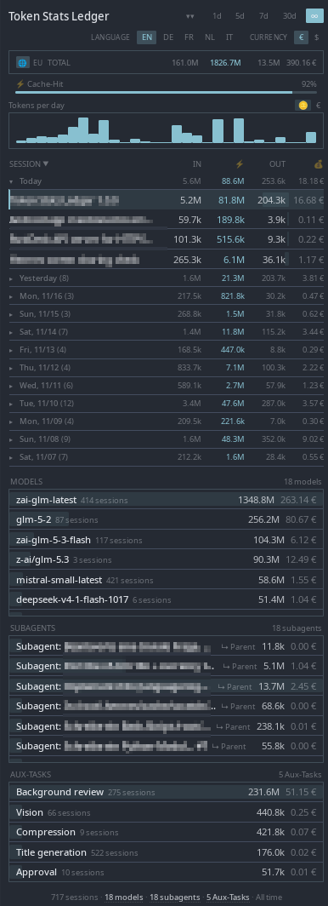

# hermes-token-stats

> [!NOTE]
> **Merged monorepo (v1.0.0).** This repository is the single home of the
> token-stats project:
>
> | Path | What |
> |---|---|
> | `plugin.js` | **Desktop plugin** — statusbar chip + pane (runs in the Hermes desktop app and the Hermes WebApp) |
> | `backend/` | **Backend stack** — known-ledger daemon (systemd), plugin backend routes (`/api/plugins/token-stats/`), web dashboard pane entry, installer |
> | `docs/`, `test_*.mjs`, `backend/test_*.py` | Mockup, pricing/i18n tests, backend test suites |
>
> The former backend repo `hermes-usage-history-rpc` was merged in via an
> unrelated-history merge (its full commit history is preserved) and is
> **archived**. Versions are unified since v1.0.0: one version number for
> repo, plugin, web entry and backend — the client `v5.x` line and the
> backend `v0.x` line both ended with the merge.

<p align="center">
  
</p>

Hermes Desktop plugin: statusbar chip + pane for per-session token usage.

## Features

**Statusbar chip** (live readout of the focused session):
- 🪙 **Tokens** — session lifetime total (input/cached/output in tooltip)
- ⚡ **Cache** — prompt-cache hit rate (from `cache_read` / prompt tokens)
- 📊 **Context** — context window fill % (amber ≥75%, red ≥90%), merged from
  `session.context_breakdown` RPC so resumed sessions show a value too
- 💰 **Cost** — client-side EUR estimate (USD table × 0.85), 2 decimals;
  `null` (no display) for unpriced models — never a fabricated number
- 🔁 **API-Calls** — lifetime provider request count

**Language & Currency (v5.0.x)** — toggleable in TWO places: the chip menu
AND a row in the pane header (same controls, always in sync) — language
(DE / EN / FR / NL / IT) and currency (€ / $):

- **UI language**: EN is the default; all UI strings (empty states,
  tooltips, day labels, footer, breakdown lists) follow the selection.
  Technical terms (Tokens, Cache, Input, Output, Calls, Ledger,
  Known-Ledger, Subagent, Aux-Tasks) stay untranslated by convention.
  Number and date formatting follows the active language's locale
  (`Intl` — e.g. German `1,50 €` vs. English `$1.50`).
- **Currency**: EUR (default) or USD. Cost estimates are computed in USD
  (list prices) and converted for display — USD renders directly as
  `$X.XX`, EUR via the fixed EUR rate (USD × 0.85, Mistral's own GLM
  listing: $1.40 ↔ €1.19); tooltips show the USD parenthetical in EUR
  mode only.
- Both settings persist via `localStorage` (`token-stats:lang` /
  `token-stats:currency`) on the desktop pane and the web dashboard pane
  alike (same keys — one preference per browser/machine).
- **Further languages**: open an issue with the *Language request*
  template — a new language is a dictionary addition, no UI code.

**Region (EU endpoint) toggle (v5.1.x)** — 🌐/EU segmented buttons in the
aggregate summary box (directly before the TOTAL label) and in the chip
menu; same atom on both surfaces:

- **🌐 Global (default)**: PAYG-equivalent costs at Mistral's global list
  prices (api.mistral.ai).
- **EU**: the premium of Mistral's dedicated EU endpoint
  (api.eu.mistral.ai) — a flat **1.1×** on all token prices (input,
  cache-read, output), matching Mistral's EU data-residency pricing.
- The factor applies at the single pricing choke point, so chip, summary,
  histogram €-metric, day separators and all breakdown lists flip
  together. Unpriced rows stay `—`, free models stay `0,00 €` — the
  factor never fabricates a price.
- Persisted like language/currency (`token-stats:region`), same key on
  desktop and web.

Every metric is toggleable via a click menu on the chip (popover, ●/○ state);
the selection persists via `ctx.storage` (`hermes.plugin.token-stats.chipShow`)
across app restarts. At least one metric stays visible — hiding all is blocked.

**Pane** (`panes` area): per-window token history for all sessions —
known-ledger data via `ctx.rest` (very old Hermes installs without plugin
backend support fall back to live-only). Since v4.4:
- **Calendar range presets**: 1d (today), 5d (Mon–Fri workweek), 7d (calendar
  week), 30d (running month), ∞ — buttons in the pane header, with the
  language + currency toggle row underneath (v5.0.1+)
- **Grand-total summary** aligned to the table columns, with a ⚡ cache-hit
  bar (share of prompt tokens served from cache)
- **Mini histogram**: tokens per day over the window (skipped on 1d — a
  single bar carries no information), with a 🪙/€ toggle switching bar
  heights between daily tokens and daily estimated PAYG-equivalent cost
- **Collapsible day groups** with per-day totals; today expanded by default
- **Per-model, per-subagent and per-aux-task breakdown lists** (footer
  toggles, bottom-pinned, with relative size bars; aux tasks = auxiliary
  API calls like background review, compression, vision, title generation)
- **Drag-resizable columns**: grab the right edge of any header cell
  (except the last) — widths persist across app restarts via
  `ctx.storage` (`hermes.plugin.token-stats.colWidths`)
- Sortable columns (activity/input/⚡/out/cost), focused session
  highlighted with the accent left border, `⚠` marks ledger-recorded
  DB resets (anomaly events), `●` live-only sessions, `≈` on totals =
  unpriced rows excluded, `—` = missing values

<a href="docs/pane-example.png" target="_blank" rel="noopener">
  
</a>

*Live installation, all-time window (session titles redacted) — click the
thumbnail to view it full-size. The footer counts aggregate over the active
window: 717 sessions, 18 models, 18 subagents, 5 aux tasks.*

*Example rendering with sample data (Nord theme): language + currency
toggles (EN / € active), calendar range presets*
(1d/5d/7d/30d/∞, 30d active), region toggle (🌐/EU) in the grand-total
summary box, grand-total summary aligned to the table
columns, ⚡ cache-hit bar, mini histogram (tokens per day over the window),
collapsible day-group separator rows with per-day totals, focused session
highlighted with the accent left border. `●` marks a live-only session, `⚠`
a ledger-recorded DB reset, `≈` on totals indicates unpriced rows excluded,
`—` marks missing values (unpriced model / no cache). The footer toggles
open the per-model, per-subagent and per-aux-task breakdown lists
(bottom-pinned, relative size bars, per-row estimated cost — `—` when a
model has no price, `≈` when unpriced rows were excluded from the row's
estimate).*

A pixel-perfect reference render with sample data lives at
[docs/pane-mockup-v1.0.0.png](docs/pane-mockup-v1.0.0.png) — generated from
`docs/pane-mockup.html`, a standalone 1:1 mockup of the pane's render logic
(sample data, Nord theme): language + currency toggles, region toggle in the
summary box, cache-hit bar, histogram, day groups, breakdown lists with
relative size bars. Regenerate after layout changes: render the HTML in a
browser at 380px width, device pixel ratio 2, capture the `#pane` element.

## Data availability — mid-month installs

> [!IMPORTANT]
> **The ledger records from its first start — it does not backfill.**
> The daemon polls live and accumulates; it never imports historical
> usage that predates its installation. Every view is affected — there
> is no view whose numbers are complete from day one:
>
> - **Calendar presets (1d / 5d / 7d / 30d / ∞)**: a window is only
>   complete where it lies entirely after the ledger's first start.
>   The `30d` running-month view becomes fully trustworthy only once
>   a **month boundary has passed since the ledger's first start**;
>   installed mid-month (e.g. Oct 15), the early days of the window
>   are absent or undercounted. The `∞` view shows the same leading
>   gap until the ledger has run long enough; `1d/5d/7d` recover
>   first — as soon as their window lies entirely after the install.
> - **Summary totals & costs**: exact for the ledger-covered portion
>   of a window, undercounted for the days before it.
> - **Per-session lifetime totals** in the sessions table: the first
>   poll baselines `known = live` (current `state.db` values), so
>   pre-ledger sessions start with their values as of the install —
>   usage from before the install that survived in `state.db` is
>   included, but usage that `state.db` already lost to
>   compression resets before the ledger existed is not.

## Install

Two ways — pick what you need. Both come from the same one-liner:

```bash
curl -fsSL https://raw.githubusercontent.com/AndiAtom/hermes-token-stats/main/backend/install.sh | bash -s -- [MODE] [--yes]
```

### Full stack (default) — chip + pane WITH history

Installs the **known-ledger backend** (plugin backend routes under
`/api/plugins/token-stats/`, incl. the custom-prices store), the
**ledger daemon** (systemd unit, polls `state.db` read-only every 15 s,
monotonic counters that survive compression resets), the **web dashboard
pane**, and the **desktop plugin file**. This is what the feature set in
this README assumes — without the backend the pane degrades to live-only
sessions (marked `live only`, no history, no custom prices via the
backend route).

```bash
# on the machine running the dashboard (port 9119):
curl -fsSL https://raw.githubusercontent.com/AndiAtom/hermes-token-stats/main/backend/install.sh | bash -s -- --yes

# or from a checkout:
( cd backend && ./install.sh )
```

The installer is idempotent — re-run any time (e.g. after a `git pull`).
A preflight checks every path and prerequisite before touching anything;
`--doctor` runs the check alone. Non-root installs get a systemd **user
unit** automatically (no sudo needed).

Then in the desktop app: ⌘K → **Reload desktop plugins**.

### Client-only (`--client-only`) — chip + live pane, zero server-side setup

Installs just the desktop plugin file
(`plugin.js → ~/.hermes/desktop-plugins/token-stats/`). No backend, no
daemon, no config edit, no dashboard restart. The pane then shows
live-only data (no session history). Manual custom prices still work —
drop a `prices.json` next to the plugin file.

```bash
curl -fsSL https://raw.githubusercontent.com/AndiAtom/hermes-token-stats/main/backend/install.sh | bash -s -- --client-only --yes
```

Want history later? Re-run without `--client-only` on the machine
running the dashboard.

### Useful flags

| Flag | Effect |
|---|---|
| `--client-only` | desktop plugin file only (see above) |
| `--hermes-home <dir>` | Hermes home directory (default `~/.hermes`; wins over the `HERMES_HOME` env) |
| `--yes` / `ASSUME_YES=1` | non-interactive |
| `--doctor` | environment check only, installs nothing |
| `--no-daemon` | backend routes + web entry, but no systemd daemon |

> The desktop app loads plugins from ITS OWN disk — installing on a remote
> gateway host does nothing for a desktop running on another machine;
> install the client part on the desktop's machine, the backend on the
> dashboard's machine. (For the Hermes **WebApp** the desktop plugin runs
> on the gateway host, so there `--client-only` on the host is enough —
> see *Hermes WebApp pane* below.)

## Web dashboard pane

The repo also ships a **web port of the pane** (`web-entry.js`,
served by the Hermes web dashboard — the same gateway process that runs the
known-ledger backend). It renders as a dashboard page at `/token-stats`:

- Same data source (ledger backend over HTTP, 30 s polling — the web UI has
  no `session.usage` event stream, so there is no live overlay; the daemon
  poll interval is the floor)
- Same pricing table, cost estimation, calendar windows and aggregation
  logic as the desktop pane — both are kept in lockstep, the desktop plugin
  is the reference implementation
- Same breakdown lists (models, subagents, aux tasks), histogram and
  drag-resizable columns; the statusbar chip and the focused-session
  breakdown overlay are desktop-only
- Language and currency toggles in the pane header (since web.1; the
  histogram's cost-metric icon follows the currency since web.2),
  persisted with the same `localStorage` keys as the desktop
- Region (EU endpoint) toggle in the summary box before the Total label
  (since web.3 / v5.1.1-web.1), same pricing factor and `localStorage`
  key as the desktop

No separate install: it deploys with the backend (`backend/install.sh`),
then the dashboard serves it automatically.

## CLI: the `/tokenstats` command

For pure CLI users — no desktop app, no dashboard — `/tokenstats` reports the
same numbers from the prompt:

```
/tokenstats                 last 7 days (default)
/tokenstats 1d              today          (also 5d, 7d, 30d, all)
/tokenstats models          per-model breakdown for the window
/tokenstats session         the session you are in — the CLI twin of the chip
/tokenstats profile trading read another ledger profile
/tokenstats --help          usage text
```

Sample:

```
Token Stats — all time (profile: default)
──────────────────────────────────────────────
  sessions     32
  input        26.11M
  cached       209.94M  (88.9% hit)
  output       741.4k
  tokens       236.79M
  api calls    2411
  cost         ≈$4.09
──────────────────────────────────────────────
  model                      tokens calls     cost
  deepseek-v4-1-flash-1017  163.93M  1892    $4.09
  gpt-6.1-sol                31.17M   191        —
  ≈ unpriced models excluded from the cost total
  ledger heartbeat: 3m ago
```

`/tokenstats` is a **native Hermes plugin** (`backend/plugin_pkg/usage/`), not a
desktop plugin: it opens `ledger.db` read-only and formats text, so it
works in the CLI where there is no React host. It needs the ledger daemon
running (installed by `install.sh`) — without it the command says so and
points at `install.sh`.

Windows are calendar-based like the pane's presets — `1d` since local
midnight, `5d` this workweek (Mon 00:00), `30d` this calendar month, plus
`all`; `7d` (the default) is the one rolling preset. Attribution uses real
session activity (`last_activity_at` from `state.db`, falling back to the
ledger's `first_seen`) — **not** the ledger's `last_poll`, which the daemon
only advances when a counter moves, so for a quiet session it is neither
last activity nor last poll.

**Prices** ship as `prices.json` next to the plugin, **generated from
`plugin.js`** by `scripts/gen_prices_usage.py` — the same `PRICES` /
`PRICES_OPENROUTER` tables the chip and pane use, so there is no second
copy to drift. Regenerate after changing a price (`python3
scripts/gen_prices_usage.py`); a test fails if the two disagree.
Resolution order matches the clients (`PRICES_PROVIDER[provider][model]` →
`PRICES[model]` → `—`), and Nous is aliased to the OpenRouter catalog the
way `plugin.js` does. Unpriced models print `—` and are excluded from the
total (`≈` prefix) rather than contributing a fabricated number.

Costs are **USD list price**. The pane's user overrides (`prices.json`
overrides / the backend `/prices` route), the EU ×1.1 region factor and the
€/$ display toggle are UI-only and are *not* applied here, so a user on
default EUR display will see a number that differs by the conversion rate.
If the price table cannot be found at all, cost shows `—` instead of a
guess.

Install:

```bash
hermes plugins enable usage
```

## Hermes WebApp pane (early support)

Since Hermes v0.22.6 the gateway can also serve the **WebApp** — the full
desktop bundle in the browser (gateway port 9120), a third surface next to
the packaged desktop app and the web dashboard. The desktop plugin runs
there **as-is**: pane and statusbar chip render and work in the WebApp
already (rudimentary — first-class support is planned for v1.2, see
roadmap).

Install via the installer's client-only mode (on the Hermes host):

```bash
# on the machine running the gateway (the Hermes host):
curl -fsSL https://raw.githubusercontent.com/AndiAtom/hermes-token-stats/main/backend/install.sh | bash -s -- --client-only --yes
# or from a checkout: plugin.js → ~/.hermes/desktop-plugins/token-stats/
# then reload the WebApp in the browser
```

Unlike the packaged desktop app — which loads plugins from **its own**
disk, so a remote copy does nothing — the WebApp loads desktop plugins
from the **gateway host's** `~/.hermes/desktop-plugins/`. Installing on
the Hermes host is all it takes; the ledger backend answers on the same
host, so `ctx.rest` works unchanged.

## Data flow (known / live / max)

```
token-stats-ledger daemon ──15s read-only poll──▶ ~/.hermes/state.db
        │  delta engine: known = monotonic, never drops
        ▼
~/.token-stats-ledger/<profile>/ledger.db
(the daemon's `LEDGER_BASE` default; the path in the data-flow diagram is
that daemon's own default, override via `LEDGER_BASE` env).
        │  plugin backend (ctx.rest namespace /api/plugins/token-stats/)
        ▼
plugin.js  ├─ Chip:  known (usePersistedUsage) ──┐
           │                                       ├─ max(live, known) per field
           ├─ Pane:  known (HistoryQuery)          │
           └─ Live overlay: session.usage events ──┘
Fallback chain per query: ctx.rest ledger → live only
(v1.0.0: the usage.history RPC hop was removed with the retired gateway
hooks; plugin.js retains a silent legacy attempt for old Hermes installs)
```

`known` counters survive compression resets and rewinds (the ledger
re-baselines instead of dropping); the ⚠ marker in the pane flags sessions
with a recorded DB-reset anomaly.

## Pricing table

### Custom prices (v1.0.0)

Models missing from the built-in tables (own gateway, unlisted model)
don't have to stay `—`. Two ways to maintain your own prices — both
merge OVER the built-ins (your keys win, unknown keys add; the built-in
tables stay as fallback and stay curated here):

**1. `prices.json` next to the plugin** (desktop):

```json
{
  "prices": {
    "my-gateway/model-x": { "input": 0.5, "cached": 0.05, "output": 1.5 }
  },
  "providerPrices": {
    "mistral": {
      "my-internal-alias": { "input": 0.3, "cached": 0.03, "output": 0.9 }
    }
  }
}
```

Place it at `~/.hermes/desktop-plugins/token-stats/prices.json`. Rates
are USD per 1M tokens; missing rates default to 0.

**2. Backend route** (works for both surfaces):

```bash
curl -X PUT http://<dashboard-host>:9119/api/plugins/token-stats/prices \
  -H 'Content-Type: application/json' \
  -d '{"prices": {"my-gateway/model-x": {"input": 0.5, "cached": 0.05, "output": 1.5}}}'
```

Stored next to the deployed backend; `GET` on the same route reads it
back. The web pane picks it up on reload, the desktop plugin on plugin
reload.

Lookup precedence, most specific first: provider-scoped user →
provider-scoped built-in → model-only user → model-only built-in. The EU
region factor applies to your overrides like to built-ins. Invalid
entries (negative, non-numeric) are dropped silently — check the
browser/devtools console for the `[token-stats]` warning listing them.

> Recommendation: store the **regular list price**, not a temporary sale
> price — the purpose is a pay-as-you-go equivalent over time. Missing a
> built-in price that SHOULD be in the curated tables? Open an issue with
> the *Provider pricing request* template — user overrides are yours,
> the built-ins are everyone's.

`cost_usd` never arrives from the gateway for `custom:` providers
(`billing_mode=unknown`, `estimated_cost_usd` stays 0.0), so the plugin prices
locally. **v4.5.0: provider-aware three-level lookup** — the estimate depends
on WHERE a model ran, not only on its name:

1. `PRICES_PROVIDER[billing_provider][model]` — exact provider match
2. `PRICES[model]` — model-only fallback (provider unknown/other)
3. `null` → pane shows `—` — never a fabricated number

The `billing_provider` comes from the ledger backend (`model_usage` rows carry
their grain's provider; session rows carry state.db's). Provider keys match
**exactly** (`openrouter`, `nous`) — `custom:mistral` deliberately falls through
to the model-only path, because a custom provider relay can bill differently.

| Table | Source | Scope |
|---|---|---|
| `PRICES` | <https://docs.mistral.ai/inference/pricing> (verified 2026-10-28) | Mistral-hosted models + fixed aliases, 45 entries |
| `PRICES_OPENROUTER` | `openrouter.ai/api/v1/models` (generated 2026-10-04) | 459 curated models — text-in/text-out, priced or free, not expired; OR routing models excluded (no own price) |
| `PRICES_PROVIDER.nous` | OpenRouter catalog (Nous publishes no machine-readable list) | same table, separately overridable when Nous' own pricing deviates |

**Regeneration** — when OpenRouter prices shift, regenerate the catalog table
in two minutes:

```bash
python3 scripts/gen_prices_openrouter.py > /tmp/prices_or.js
# replace the marked PRICES_OPENROUTER block in plugin.js with the output
node --test test_prices.mjs   # spot checks + normalization regressions
```

Full coverage of all token-billed models on La Plateforme, cross-checked
against the live `/v1/models` API:

> **Your provider is missing?** The catalog tables currently cover Mistral,
> OpenRouter and Nous (via the OpenRouter catalog). If you run models through
> another provider and want correct cost estimates, **open an issue** — use the
> *Provider pricing request* template. Provider tables are small, exact-match
> additions are welcome (source must be the provider's own price list).

| Family | Model | Input | Cached | Output |
|---|---|---|---|---|
| Premier | Mistral Large 4 (`mistral-large-4`, `mistral-large-4-0`, `mistral-large-4-0-8`(-`fp4`))² | 0.70 | 0.07 | 2.10 |
| | Mistral Large 3 (`mistral-large-latest`) | 0.50 | 0.05 | 1.50 |
| | Mistral Medium 3.5 (`mistral-medium-latest`) | 1.50 | 0.15 | 7.50 |
| | Mistral Small 4 (`mistral-small-latest`) | 0.15 | 0.015 | 0.60 |
| Edge | Ministral 3 14B / 8B / 3B (`ministral-*-latest`) | 0.20 / 0.15 / 0.10 | 10% of input | = input |
| Code | Codestral (`codestral-latest`) + `mistral-code-*` / `mistral-vibe-cli-*` | 0.30 | 0.03 | 0.90 |
| Reasoning | Magistral Medium (`magistral-medium-latest`)¹ | 2.00 | 0.20 | 5.00 |
| | Magistral Small (`magistral-small-latest`)¹ | 0.50 | 0.05 | 1.50 |
| Audio | Voxtral Small (`voxtral-small-latest`)¹ | 0.10 | 0.01 | 0.30 |
| Third-party | Z.ai GLM 5.3 / 5.2 (`zai-glm-latest`) | 1.40 | 0.14 | 4.40 |
| | Z.ai GLM 5.3 Flash (`zai-glm-5-3-flash`) | 0.15 | 0.03 | 0.50 |
| | DeepSeek V4.1 Flash 1017 (`deepseek-v4-1-flash-1017`) | 0.30 | 0.007 | 1.20 |
| Embeddings | Codestral Embed / Mistral Embed | 0.15 / 0.10 | 10% of input | — (input-only) |
| Free | Leanstral 1.5, Mistral Moderation 2 | 0.00 | 0.00 | 0.00 |

Fixed-version API aliases (e.g. `mistral-medium-2604`, `ministral-8b-2512`,
`codestral-2508`, `zai-glm-5-3`) are priced identically to their `-latest`
aliases — 45 entries total in `PRICES`.

¹ *Magistral is deprecated on the API (replacements: Medium 3.5 / Small 4) —
legacy list prices, no longer on the official page. Voxtral Small likewise
removed from the page; last verified list price (Sep 2026).*

² *Mistral Large 4 is in public preview with a temporary sale price
($0.68/$0.07/$2.09). We deliberately track the regular list price instead:
the estimate is a PAYG-equivalent, not a mirror of a time-limited discount —
preview pricing expires, list prices don't.*

**Not priced** (non-token billing, `estimateCost()` → `null` → pane shows `—`):
Voxtral Mini Transcribe ($/min), Voxtral TTS ($/M chars), Mistral OCR ($/1000
pages). Devstral was fully retired from the API and is absent.

Verified against <https://docs.mistral.ai/inference/pricing> (2026-10-28).
The gateway's `input` already **excludes** cached tokens
(`input = prompt_total − cache_read − cache_write`), so the estimate is
`input×in + cache_read×cached + output×out`, EUR = USD × 0.85
(Mistral's own GLM listing: $1.40 ↔ €1.19).

## Roadmap

> **Versioning since v1.0.0:** ONE unified version number for everything —
> repo, desktop plugin, web entry, backend, releases. The client lines
> (v4/v5.x) and the former backend repo's line (v0.x) both ended with the
> v1.0.0 monorepo merge; the old `-web.N` suffix is retired.

**v1.0.0 (shipped — the monorepo release)**

- **Monorepo merge:** the former backend repo
  [`hermes-usage-history-rpc`](https://github.com/AndiAtom/hermes-usage-history-rpc)
  was merged into this repository (unrelated-history merge — its full
  commit history is preserved here) and **archived**. The backend lives on
  as [`backend/`](backend/) (ledger daemon, plugin backend routes, web
  dashboard entry, installer). All development, releases and install
  paths happen in THIS repo from now on.
- **Legacy gateway RPCs retired:** the `usage.history` / `usage.totals`
  JSON-RPC methods (patched into the gateway's `server.py`) are gone.
  The plugin backend (`/api/plugins/token-stats/*`) is the only data
  path; the installer no longer touches `$HERMES_LIB` — **Hermes updates
  no longer wipe anything this installer deploys**. Old Hermes installs
  (< 0.21.4, no plugin backend support) degrade gracefully to live-only.
- **Custom prices (user price overrides):** maintain your own prices for
  models the built-in tables don't cover — `prices.json` next to the
  plugin (desktop) or `PUT /api/plugins/token-stats/prices` (backend).
  See [*Custom prices*](#custom-prices-v100).
- **Pane polish:** the TOTAL summary label baseline is fixed (region
  toggle buttons no longer shift it), pane retitled to
  **“Token Stats Ledger”**.
- **Two install modes:** `install.sh` default (full ledger stack) and
  `--client-only` (desktop plugin file only). See
  [*Install*](#install).

**v1.1.0** — first-class **Hermes CLI** support. The ledger daemon
already records everything, but a pure CLI user (no desktop app, no headless
pane) had no way to *see* their numbers without opening a dashboard. This
adds a `/tokenstats` slash command to the Hermes CLI so token stats are queryable
directly from the prompt:

```
/tokenstats                 token totals for the last 7 days (default)
/tokenstats 1d              today only (also: 5d, 7d, 30d, all)
/tokenstats models          per-model breakdown for the window
/tokenstats session         the current session only (the CLI twin of the chip)
/tokenstats profile trading read another ledger profile
```

It ships as a **native Hermes plugin** (`backend/plugin_pkg/usage/`) that
reads `ledger.db` directly in `mode=ro` — no gateway route, no desktop
app, and the same source the chip and pane read, so the numbers agree.
Unpriced models render `—` and are excluded from the total (marked `≈`)
rather than contributing a fabricated cost. The session view (`v1.1.1`)
composes with all of the above — `/tokenstats session profile trading`
reads the current session from the trading profile's ledger. See
[*CLI: the `/tokenstats` command*](#cli-the-usage-command).

**v1.2.0 (planned)** — first-class **Hermes WebApp** support (the
browser-hosted desktop served by the gateway, Hermes ≥ v0.22.6). The pane
and chip already render and work in the WebApp as-is (see *Hermes WebApp
pane* above); v1.2 turns that into first-class support:

- **Mobile interface** — the WebApp is the natural surface for phones;
  the pane needs responsive treatment for small screens (the fixed 380px
  desktop-pane geometry does not translate to a phone browser)
- **Documented, smooth install path** — today the WebApp pane is
  installed by the installer's client-only mode (plugin.js to
  `~/.hermes/desktop-plugins/token-stats/` on the Hermes host) plus a
  WebApp reload; v1.2 documents this path properly and makes it a
  one-step flow

**v1.3.0 (planned)** — scope: consumer tracking + the native "hermes proxy"

- **hermes-proxy integration:** `hermes proxy` (local OpenAI-compatible
  forwarder to OAuth providers — external apps point at it with any bearer
  token) needs proper coverage in the stats. Open questions to resolve at
  build time: how do proxied requests land in state.db (source?
  billing_provider? separate profile?) — verify what the proxy actually
  writes before designing anything. Goal: usage that runs through the
  proxy must be visible in the pane (and priced correctly via the
  custom-prices layer, incl. provider-scoped overrides if the proxy
  reports its own provider string).
- **LiteLLM consumer tracking** (previous plan for this slot, scope
  flexible): optional integration with a self-hosted
  [LiteLLM](https://github.com/BerriAI/litellm) proxy — the backend reads
  its Postgres spend logs and the pane shows **consumers** (services that
  run models OUTSIDE Hermes — e.g. Honcho, Hindsight) as a fourth
  breakdown section with tokens + cost per service.
  **Fully optional:** Hermes' own usage keeps flowing through the
  existing state.db ledger, unchanged. If the native hermes-proxy route
  covers the real-world use cases, LiteLLM can stay parked — decide at
  build time which (or both) paths ship.

**v2.0.0 (planned, far future)** — cross-platform support:

- **Windows and possibly macOS.** The ledger core (engine, poller, daemon)
  is pure Python stdlib and should run as-is; the work is all around it:
  the installer is GNU-flavored shell (grep -P, stat -c, ss, sed idioms),
  systemd has no equivalent on Windows (a Windows service or scheduled
  task would host the daemon; macOS would need a launchd plist), and the
  Hermes install layouts on those platforms need live verification
  against real hardware before any of it is promised.
- No timeline yet. This lands when there is hardware to test on and
  demand from users on those platforms; until then Linux is the only
  supported platform. `--doctor` output attached to an issue tells us
  most of what we would need to know without the hardware.

<details>
<summary><strong>Release history before v1.0.0 (unified era only — back then split across two repos)</strong></summary>

**Shipped in v5.2.x** — server-side window aggregation + full-window
display list (fixes silently shrinking window totals AND vanishing days):

- **Why:** the pane queried `/ledger` with `limit=200` and summed the
  returned `sessions[]` — but the backend sorts by activity and cuts at
  `limit`, so every new session pushed old (expensive) ones out of the
  window sum (observed: top-200 sum 111.61 € vs 120.03 € full window)
- **v5.2.0 Fix:** the backend (≥ v0.7.0, `totals=1` param) aggregates the
  FULL window server-side before the limit cut; summary totals, cost and
  the footer session count come from `totals` and are limit-independent
- **v5.2.1 Fix:** the display list itself still cut at the top-200 — in
  a busy window the cut falls inside the window and entire oldest days
  vanished from the session list and histogram (all 18 sessions of
  Oct 1 invisible). Display limit raised to 2000
- The session display list is display-only; costs are still priced
  client-side from `totals.by_model` (the server stays price-free)
- New i18n key `windowSessions` (footer session-count tooltip)

**Shipped in v5.1.x** — region (EU endpoint) pricing toggle for both the
desktop pane and the web dashboard pane:

- **Region toggle** — 🌐/EU segmented buttons in the summary box (before
  the TOTAL label) and in the chip menu; EU mode multiplies all token
  prices by 1.1 (Mistral's api.eu.mistral.ai premium)
- Same `localStorage` key on both surfaces (`token-stats:region`);
  unpriced rows stay `—`, free models stay `0,00 €` in EU mode

**Shipped in v5.0.x** — language & currency support for both surfaces:

- **Language toggle** — UI languages DE, EN (default), FR, NL, IT;
  further languages via GitHub issue (*Language request* template)
- **Currency toggle** — € / $ display for all cost estimates; the
  histogram's cost-metric icon follows the selection
- Both settings persist via `localStorage` and apply to the desktop pane
  and the web dashboard pane alike

</details>

## Known pitfalls (encoded in blood)

- The plugin loader scans for imports with a **regex over raw source** — a
  `from "word"` pattern inside a COMMENT or string literal fails the load with
  `unsupported import: <word>`. Never write import-looking prose in comments.
- **Never short-circuit hooks**: `useValue(a) || useValue(b)` changes the hook
  count between renders → React throws "Rendered more hooks than during the
  previous render" → the chip degrades to the ⚠ `token-stats:chip` fallback
  until clicked. Call both hooks, combine the values.
- Resumed sessions report no `context_*` fields in the streamed usage; merge the
  `session.context_breakdown` RPC over it (what core's statusbar gauge does).

## License

[MIT](LICENSE) — © 2026 AndiAtom
